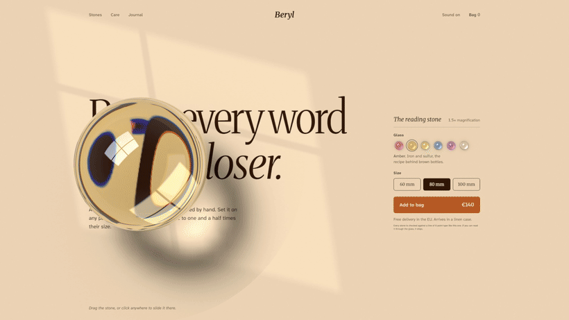

# Beryl

A product page for a glass reading stone, where the stone is real. Slide it across the page and the words swell under it. Tap it and rings run across the glass like water.

[**Play with it live**](https://sam1983aing.github.io/beryl/) · [**The prompt**](PROMPT.md) · [**Source**](https://github.com/Sam1983Aing/beryl) · [**20 second clip**](media/beryl-demo.mp4)



Built with [Claude Code](https://claude.com/claude-code) and Claude Opus 5.5 over three rounds of feedback, starting from my earlier Atmosphere glass study. The prompt to build your own is in [PROMPT.md](PROMPT.md).

## Try it

Best on a laptop, with the sound on.

- Drag the stone. The words under it rise to one and a half times their size, the way a reading stone did before spectacles.
- Tap it. Rings run across the glass and it rings with a glass tone.
- Click anywhere on the page and the stone glides there.
- Pick one of six glasses. The new colour spreads across the page from the bead you picked, and the light under the stone takes the colour of the glass.
- Pick a size, 60, 80 or 100 mm, and the stone grows or shrinks in place.
- There's a line of 6 point type under the button. Slide the stone over it and you can read it.
- With the keyboard: Tab to the stone, the arrow keys move it word by word, Enter taps it.

## How it's made

One HTML file, raw WebGL2 and the Web Audio API. No images, no 3D models, no audio files and no libraries.

**1. The glass is traced, not baked.** Every pixel under the stone follows its camera ray into a real hemisphere: Fresnel reflection off the dome, refraction in, then up to five events inside. Rays that hit the flat base too steeply bounce back up, because there's a thin layer of air between glass and paper. That total internal reflection is what draws the dark ring round the edge, the same as a real paperweight. It runs once per colour channel with slightly different refractive indices (1.548, 1.553, 1.563), which gives the colour fringes on the letters near the rim.

**2. The light on the page is traced too.** When the page loads, plain JavaScript fires a regular grid of rays from the sun, the window and the room through a unit dome and bins where they land on the paper. That gives the caustic and the soft shadow, with open paper normalised to exactly 1, in about 84 ms. The four-pane window you see reflected in the glass also falls across the page with soft crossbar shadows, and the stone's caustic is only sharp where the sun reaches it. Every so often a cloud passes and the whole light softens.

**3. The page is printed.** The real text stays in the DOM, transparent, so it can still be selected and read by screen readers. Each word's position is measured with a `Range` and drawn into a canvas texture: red for ink, green for the button colour, blue for the softer ink. The shader reads that texture through the glass with proper filtering, so magnified words stay sharp. A blurred copy of the same texture works as a height map, which presses the ink into the paper like letterpress. Hovering a button presses it a little deeper.

**4. Six glasses, six metals.** Each colour is a metal in the melt: gold for ruby, iron and sulfur for amber, chromium for green, cobalt for blue, manganese for violet, and very little iron for clear. Each has its own paper stock, ink and button colour. The six small beads are traced with the same optics as the big stone, and the stone bumps into them instead of sliding over.

**5. The motion.** A click sends the stone along two critically damped springs in a row, so it leaves rest with no jolt and settles with no overshoot. A press adds a travelling ring to the glass surface (up to four at once) that tilts the surface by about 7 degrees. The render loop sleeps whenever nothing is moving.

**6. The sound is synthesised.** A soft knock of glass on paper, the crystal's partials and a quiet tonal bed, pitched by where you tap. Sliding adds a breath of filtered noise that follows the stone's speed.

## Run it locally

```bash
python3 -m http.server 8000
```

Then open http://localhost:8000/. Opening `index.html` directly also works, since there are no modules to load.

## Structure

```text
index.html             the whole page: layout, shaders, light tracer, sound
media/beryl.gif        the preview in this README
media/beryl-demo.mp4   a 20 second clip at 1920 by 1080
media/preview.jpg      the link preview image
PROMPT.md              the prompt
```

## Notes

- Needs WebGL2 and a network connection for the Google Fonts (Merriweather and Atkinson Hyperlegible Next). Without WebGL the page still shows its text and controls.
- Beryl, the shop and the prices are made up. This is a design study, with no link to any company called Beryl.

Made by Samnang Aing. I share builds like this as I go on [X](https://x.com/SammmAing) and [Threads](https://www.threads.com/@samnang.aing).
